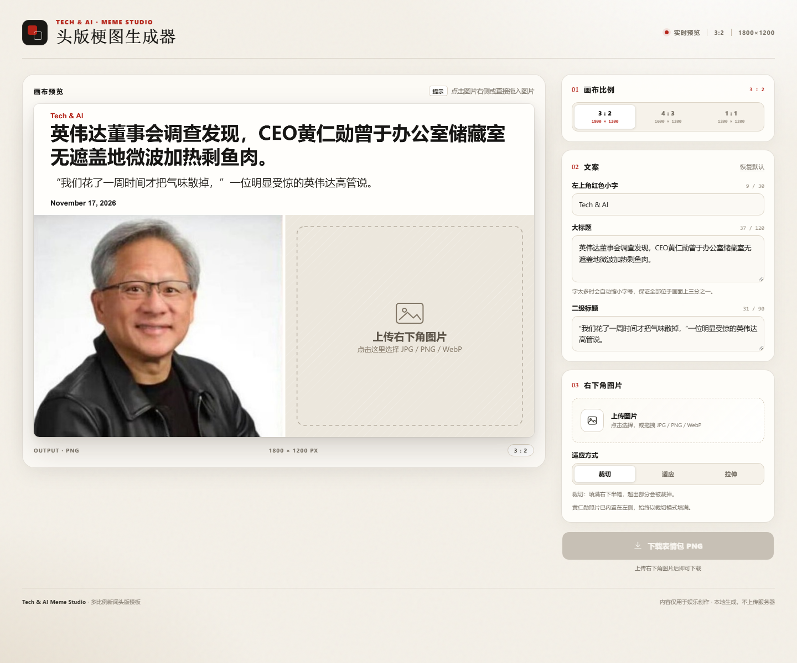

# Tech & AI 头版梗图生成器

一个纯前端、单文件的科技新闻头版梗图生成器。打开 `index.html` 即可在浏览器中编辑文案、上传右下角配图，并导出高清 PNG。

## 功能

- **可编辑文案**
  - 左上角红色小字，默认 `Tech & AI`
  - 大标题，默认「英伟达董事会调查发现，CEO黄仁勋曾于办公室储藏室无遮盖地微波加热剩鱼肉。」
  - 二级标题，默认「“我们花了一周时间才把气味散掉，”一位明显受惊的英伟达高管说。」
  - 黑色日期固定为 `November 17, 2026`，字号与左上角小字一致
  - 文字自动缩放，全部内容严格位于画面上三分之一
- **内置黄仁勋照片**：左侧图片已内嵌在 HTML 中，无需额外图片文件
- **右下角自选图片**：支持点击、拖拽上传 JPG / PNG / WebP
- **三种图片适应模式**
  - 裁切：填满面板，超出部分被裁掉
  - 适应：完整显示图片，留白与整体底色一致
  - 拉伸：铺满面板，比例不一致时会变形
- **三种画布比例**

  | 比例 | 输出尺寸 |
  | --- | --- |
  | 3:2 | 1800 × 1200 px |
  | 4:3 | 1600 × 1200 px |
  | 1:1 | 1200 × 1200 px |

- **本地导出**：下载 1800/1600/1200 宽的高清 PNG，图片不会上传到任何服务器

## 使用方法

1. 用浏览器打开 `index.html`。
2. 选择画布比例。
3. 修改左上角小字、大标题和二级标题。
4. 点击右下角预览区或上传框，选择配图。
5. 选择右下角图片的适应方式。
6. 点击「下载表情包 PNG」。

> 只有上传右下角图片后，下载按钮才会启用。

## 文件说明

| 文件 | 说明 |
| --- | --- |
| `index.html` | 完整应用，包含样式、脚本和内嵌黄仁勋照片 |
| `preview.png` | 界面预览截图 |

## 技术说明

- 纯 HTML + CSS + JavaScript，无外部依赖，可离线使用
- 使用 Canvas 2D 绘制与导出图片
- 文字自动换行、自动缩放，并按上三分之一区域约束排版
- 建议使用较新的 Chrome、Edge、Firefox 或 Safari

## 免责声明

本项目仅用于娱乐与创意表达，生成的图文内容不代表任何真实新闻或事实。
